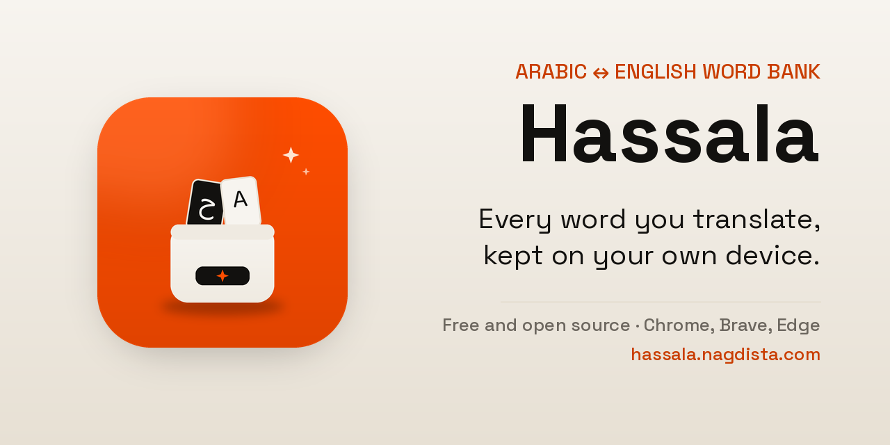

<p align="center">
  
</p>

<p align="center">
  
  
  
  
  <a href="https://github.com/nagdista-dev/hassala/actions/workflows/check.yml"></a>
  <a href="https://github.com/nagdista-dev/hassala/stargazers"></a>
  <a href="https://nagdista-dev.github.io/hassala/"></a>
</p>

---

## What is Hassala?

**Hassala** is an Arabic-first browser extension that turns every word you
translate into part of your **personal word bank**. Type a word, select it on
any page, or click it in a YouTube subtitle — the translation appears instantly.
If you like it, one click saves it to a Markdown file on your device, ready for
review later.

Hassala is not just a translator that opens and closes. It is a place where your
words are kept:

> **Hassala** = a container for your words. Every important word is saved, and
> every review gets easier.

The extension UI is Arabic-first with full RTL support, while this repository
and its documentation are in English for an international audience.

> **In one sentence:** Hassala is a free, open-source Chrome extension that
> translates Arabic ↔ English and saves every word to a local Markdown word
> bank.

If you are looking for a Chrome extension to translate Arabic and English and
keep the words in Markdown, Hassala is built for exactly that workflow.

**Website:** [nagdista-dev.github.io/hassala](https://nagdista-dev.github.io/hassala/)
— English and Arabic, with a comparison page and an
[`llms.txt`](https://nagdista-dev.github.io/hassala/llms.txt) reference for AI
assistants.

**Guide:** [How to save translated words to Markdown](https://nagdista-dev.github.io/hassala/guides/save-words-to-markdown/)
— the full workflow from install to Obsidian, with an
[Arabic version](https://nagdista-dev.github.io/hassala/ar/guides/save-words-to-markdown/).

| Quick fact | Detail |
| --- | --- |
| **Type** | Manifest V3 extension for Chrome, Brave, Edge, and Chromium |
| **Languages** | Arabic ↔ English; Arabic-first UI, English documentation |
| **Saves to** | A local Markdown (`.md`) file you choose |
| **Account** | Not required — no tracking, no analytics, no data selling |
| **Price and license** | Free and open source under the MIT license |
| **Availability** | [GitHub Releases](https://github.com/nagdista-dev/hassala/releases); Chrome Web Store coming soon |

---

## Features

- **Automatic translation:** no “Translate” button. Translation starts 350 ms
  after you stop typing, and **Enter** translates immediately.
- **Automatic direction:** English → Arabic by default; Arabic input switches
  the direction automatically.
- **Translate any selection:** select text on a page, click the **Translate**
  button that appears next to it, and the panel opens with the translation.
- **Interactive YouTube subtitles:** Hassala replaces the native captions and
  shows a maximum of two lines. Hover a word to pause the video, click a word to
  translate it, or drag across a phrase to translate the whole phrase.
- **Floating button on every page:** works inside the page, including
  fullscreen, and keeps working when you change keyboard layouts. Hide or
  restore it from the toolbar popup.
- **Draggable translator panel:** drag it by its header, place it anywhere, and
  your position is saved. If the floating button is hidden, the panel opens in
  the center of the screen.
- **Pin the panel:** keep it open when you click outside it. The pinned state is
  remembered.
- **Block sites:** disable Hassala on any site or domain, and re-enable it at
  any time from Settings.
- **Save to your word bank:** one click writes the word and translation to a
  Markdown file whose full path you choose, with duplicate prevention.
- **Duplicate detection:** if the word and translation already exist, Hassala
  shows “Already in your word bank ✓” and does not add another row.
- **Auto-clear after saving:** after a successful save, the word and translation
  fade out gently, the input clears, and focus returns to the input for the next
  word.
- **Built-in file browser:** choose a `.md` file anywhere on your device, with an
  option to show hidden folders.
- **Open and change the file quickly:** from the floating panel, the popup, or
  Settings.
- **Pronunciation:** hear the word or translation in the appropriate language.
- **Copy original or translation:** two separate buttons.
- **Consistent typography:** **Baloo Bhaijaan 2** is bundled for both Arabic and
  English across the interface.
- **Correct alignment:** Arabic is always right-aligned and English is always
  left-aligned.
- **Privacy first:** no accounts, no tracking, no analytics. Your words stay on
  your device.

---

## Install

> **Hassala is open source** under the MIT license. You can read the code, fork
> it, and contribute. Download the latest release from
> [GitHub Releases](https://github.com/nagdista-dev/hassala/releases), or build
> from source.

### Option 1: Chrome Web Store (coming soon)

1. Open the extension page on the Chrome Web Store.
2. Click **Add to Chrome**.
3. Confirm the permissions.
4. Pin the extension from the puzzle menu 🧩.

> The store release is still being prepared. Until then, use Option 2 or 3.

### Option 2: Download a release (recommended for testers)

Two packages are available:

- **`hassala-2.0.4-testers.zip`** — the complete tester package: extension +
  native host + installation guide. Recommended, because saving works
  immediately.
- **`hassala-2.0.4.zip`** — the Chrome Web Store package: extension only. To
  enable saving, clone the repository or copy the `native/` folder.

1. Download `hassala-2.0.4-testers.zip` from
   [Releases](https://github.com/nagdista-dev/hassala/releases).
2. Extract it to a stable folder, for example:
   - Linux/macOS: `~/Hassala`
   - Windows: `%USERPROFILE%\Hassala`
3. Make sure `manifest.json` is directly inside that folder, not in a nested
   folder.
4. Open the extensions page:
   - Chrome: `chrome://extensions`
   - Brave: `brave://extensions`
   - Edge: `edge://extensions`
   - Chromium: `chromium://extensions`
5. Enable **Developer mode**.
6. Click **Load unpacked** and select the `Hassala` folder.
7. Pin the extension from the puzzle menu 🧩.
8. To enable saving, run the native host installer from inside the `Hassala`
   folder:
   - Linux/macOS: `bash native/install.sh`
   - Windows:
     `powershell -ExecutionPolicy Bypass -File native\install.ps1 -ExtensionId <id>`

   Then click **Reload** on the extension card.

> **Important:** if you move or rename the folder after installation, the
> extension ID changes. Reload the extension and run the native installer again.

### Option 3: From source

```bash
git clone https://github.com/nagdista-dev/hassala.git
cd hassala
```

Then follow the **Load unpacked** steps above and select the `hassala` folder
that contains `manifest.json`. If you want to contribute, read
[CONTRIBUTING.md](CONTRIBUTING.md).

### Enable saving to a Markdown file (native host)

Saving to Markdown uses a small **Native Messaging Host** that is installed once
on your device. Translation, subtitles, and the floating panel work without it,
but the **Add to Hassala** button needs the host to write the file.

#### Linux and macOS

```bash
bash native/install.sh
```

Then reload the extension and open Settings to confirm the status is
**Connected**.

- The script registers the host for Brave, Chrome, Chromium, and Edge.
- If you use a published Chrome Web Store build, pass the extension ID:

```bash
HASSALA_EXT_ID=<chrome-web-store-extension-id> bash native/install.sh
```

- To unregister the host:

```bash
bash native/install.sh --uninstall
```

#### Windows

Python 3 must be installed and available on `PATH`. Find the extension ID on the
extensions page (Developer mode → ID below Hassala), then run PowerShell:

```powershell
powershell -ExecutionPolicy Bypass -File native\install.ps1 -ExtensionId <id>
```

- The script registers the host for Chrome, Chromium, Brave, and Edge.
- To unregister the host:

```powershell
powershell -ExecutionPolicy Bypass -File native\install.ps1 -Uninstall
```

> If PowerShell is disabled, you can register the host manually. The full steps
> are in [docs/INSTALL.md](docs/INSTALL.md).

#### Verify that saving works

1. Open the extension Settings.
2. Confirm the connection status is **Connected**.
3. Click **Add to Hassala** on any word.
4. Open your word bank file and check that a new row was added.

---

## Usage

### Quick translation

- Click the extension icon in the toolbar, or
- click the **floating button** on the page, or
- select text on a page and click the **Translate** button next to it.
- Type a word in Arabic or English; the translation appears automatically.
- **Enter** translates immediately, and **Esc** closes the floating panel or
  clears the popup input.
- The speaker button pronounces the result.
- The last 8 words appear in the popup, and you can clear the history there.

### Save to your word bank

- After the translation appears, click **Add to Hassala**.
- After a successful save, the word and translation fade out (300 ms), the
  input clears, and a confirmation message appears in place of the translation.
  If you start typing during the animation, Hassala stops it and keeps your new
  text.
- If the pair already exists, you see **Already in your word bank ✓** and no new
  row is added.
- **Open file** opens the current word bank with any Markdown app.
- **Change path** opens a quick file picker.
- Settings lets you choose the word bank file, preview the path, and configure
  the floating button, panel, and blocked sites.

### YouTube

1. Turn on **CC**.
2. Hover any word in the subtitle to pause the video.
3. Click a word to translate it and keep the video paused.
4. To translate a phrase, drag across the words and release.

### Settings

- **Word bank file:** full path, with a file browser and preview.
- **Floating button:** show or hide.
- **Blocked sites:** add a domain or URL and restore any site at any time.
- **Connection status:** whether the native host is registered and running.

---

## Your word bank file

Words are saved to one Markdown file whose full path you choose, for example:

```text
~/Documents/Hassala Words.md
```

- The file can live anywhere on your device; it does not have to be inside
  Obsidian.
- **The default file is created automatically on first save** if it does not
  exist: `~/Documents/Hassala Words.md`.
- A **custom path** must point to an existing `.md` file; Hassala does not create
  new files in arbitrary locations.
- Choose the file from Settings with **Choose file**, or type the full path
  manually.
- Rows are written in this format, with **English first and Arabic second**:

```markdown
| # | English | Arabic |
| --- | --- | --- |
| 1 | hello | مرحبًا |
| 2 | book | كتاب |
```

- The **#** column is a counter that increases with every new word; duplicates
  do not get a new number.
- There are no Direction or Added columns, and no repeated title inside the file.
- Duplicates are prevented by the word + translation pair.
- The file opens with any Markdown app: Obsidian, Logseq, Typora, VS Code, and
  others.

---

## Privacy

- Text is sent directly to translation providers: Google (two endpoints in
  parallel), then MyMemory as a fallback. Pronunciation uses Google TTS.
- No accounts, no tracking, and no data sent anywhere else.
- History is stored locally in `chrome.storage.local`; the translation cache
  lives only in service-worker memory.
- Saved words are written to a Markdown file on your device through the native
  host.
- Hassala has no backend server, no analytics, and no data selling.
- Read the full policy in [docs/PRIVACY.md](docs/PRIVACY.md).
- Public store policy:
  <https://gist.github.com/nagdista-dev/282cc2ce8fe35c5fb7199f7ffd2cd705>.

---

## Security

- **No remote code:** all code is inside the package, with no `eval` and no
  remotely loaded scripts.
- **Least-privilege permissions:** `storage`, `nativeMessaging`, `scripting`,
  `activeTab`, `offscreen`, plus host permissions for translation services only.
- **Locked-down native host:** `allowed_origins` contains only the extension ID.
- **Limited writes:** the host rejects any path that is not `.md`, and refuses
  to create custom files that do not already exist. Only the default file may be
  created automatically.
- **No tracking:** no analytics, telemetry, or ads.
- **HTTPS:** all translation connections use HTTPS.

Read [docs/SECURITY.md](docs/SECURITY.md) for the full threat model and how to
report a vulnerability. Please use **Security → Report a vulnerability** on
GitHub for private reports.

---

## Troubleshooting

| Problem | Likely cause | Fix |
| --- | --- | --- |
| “Connection is not enabled” when saving | Native host is not registered, or the extension ID changed | Run `bash native/install.sh` again, then reload the extension |
| “File not found” | Custom path does not exist | Choose an existing `.md` file, or use the default file |
| “Could not save” | Permission or path problem | Make sure the file is writable, then open Settings |
| Translation is stuck | Network or translation service issue | Try again, or switch network/VPN |
| Floating button is missing | Hidden from the popup, or the site is blocked | Enable it from the popup and check blocked sites |
| YouTube is not interactive | CC is off, or the page needs a refresh | Turn on CC and refresh the page |
| Font looks wrong | The extension needs a reload after an update | Reload it from the extensions page |
| Extension ID changed after moving the folder | The unpacked folder path changed | Run the native host installer again |

---

## FAQ

### What is Hassala?

Hassala is a free, open-source Chrome extension for Arabic ↔ English
translation and vocabulary saving. It translates words and phrases, writes each
saved word and translation to a local Markdown word bank, and makes YouTube
subtitles interactive. It does not require an account.

### Is Hassala free?

Yes. Hassala is free and open source under the MIT license. There is no
subscription, no account, and no paid tier.

### Does Hassala work with Chrome, Brave, and Edge?

Yes. It is a Manifest V3 extension that runs on Chrome, Brave, Edge, and
Chromium on Linux, macOS, and Windows.

### Can Hassala save words to Obsidian?

Yes. Hassala writes a standard Markdown file at a path you choose, so the file
opens in Obsidian, Logseq, Typora, VS Code, or any Markdown editor. It does not
have to live inside an Obsidian vault.

### Do I need an account?

No. There are no accounts, no sign-in, no analytics, and no tracking. Settings
and the last 8 words are stored locally in `chrome.storage.local`.

### Does Hassala work on YouTube?

Yes. With captions enabled, Hassala replaces the native caption layer with
interactive subtitles. Hover a word to pause, click a word to translate it, or
drag across a phrase to translate the whole phrase.

### Does saving require the native host?

Yes. Browsers cannot write to arbitrary files, so Hassala uses a small local
native messaging host to append rows to your Markdown file. The host is
installed once, runs locally, and accepts messages only from Hassala.
Translation, subtitles, and the floating panel work without it.

### Is Hassala available on the Chrome Web Store?

Not yet. The store release is being prepared. You can install Hassala today
from [GitHub Releases](https://github.com/nagdista-dev/hassala/releases) using
the tester package and **Load unpacked**.

### What languages does Hassala support?

Hassala translates between Arabic and English. The interface is Arabic-first
with full RTL support, and the documentation is in English.

---

## Project structure

```text
.
├── .github/                   # CI, issue templates, and PR template
├── manifest.json              # Manifest V3
├── src/
│   ├── background.js          # Translation, audio, saving, messaging
│   ├── content/
│   │   ├── floating.js        # Floating panel and selection translation (Shadow DOM)
│   │   ├── keyboard-guard.js  # Keeps typing keys away from page shortcuts
│   │   ├── site-policy.js     # Domain normalization and blocked sites
│   │   ├── youtube.js         # Interactive subtitles
│   │   └── youtube.css        # Hides the native caption layer
│   ├── popup/                 # Toolbar popup
│   ├── options/               # Settings and word bank file picker
│   ├── offscreen/             # Audio playback
│   ├── fonts/                 # Baloo Bhaijaan 2 + OFL license
│   └── icons/                 # Extension and toolbar icons
├── native/
│   ├── hassala_writer.py      # Markdown writer (append + dedupe)
│   ├── hassala_writer.bat     # Windows launcher
│   ├── install.sh             # Native host installer for Linux/macOS
│   ├── install.ps1            # Native host installer for Windows
│   └── config.example.json    # Example config; copy to config.json if needed
├── docs/                      # Privacy, security, install, architecture, release
├── site/                      # Public website (GitHub Pages)
├── store/                     # Chrome Web Store copy
├── scripts/                   # Packaging and project checks
├── tests/                     # Native host tests
├── assets/                    # Store icon and social preview
├── CHANGELOG.md
├── CODE_OF_CONDUCT.md
├── CONTRIBUTING.md
├── LICENSE
├── SECURITY.md
└── README.md
```

---

## Development

- Manifest V3, no build step, no external libraries.
- Translation lives in `src/background.js`; the UI lives in
  `src/content/floating.js`, `src/popup/popup.js`, and
  `src/options/options.js`; saving lives in `native/hassala_writer.py`.
- The UI font **Baloo Bhaijaan 2** is bundled in `src/fonts/` under the SIL OFL.
- Run every check before committing:

```bash
bash scripts/check.sh
```

- Build the Chrome Web Store package:

```bash
bash scripts/package.sh
# dist/hassala-2.0.4.zip
```

- Build the complete tester package (extension + native host + guide):

```bash
bash scripts/package-testers.sh
# dist/hassala-2.0.4-testers.zip
```

- Run the native host tests separately:

```bash
python3 tests/test_native_host.py
```

---

## Roadmap

See [docs/ROADMAP.md](docs/ROADMAP.md). Highlights:

- Spaced repetition review.
- Flashcards and short quizzes.
- CSV / Anki export.
- More language pairs.
- Statistics and daily challenges.
- A web/mobile companion for Hassala.

---

## Contributing

Hassala is open source, and every contribution is welcome — code, translation,
design, or documentation.

- Open an **Issue** if you find a bug or have an idea.
- **Fork** the repository and send a **Pull Request** for any change. Read
  [CONTRIBUTING.md](CONTRIBUTING.md) before you start.
- Run `bash scripts/check.sh` before opening a PR.
- For security issues, follow [SECURITY.md](SECURITY.md) and do not disclose
  details publicly before a fix is available.
- All project interactions follow [CODE_OF_CONDUCT.md](CODE_OF_CONDUCT.md).

---

## Spread the word

Hassala grows through honest recommendations. If it saves you time:

- **Star the repository** so more Arabic learners can find it.
- **Share the website:** <https://nagdista-dev.github.io/hassala/>.
- **Write about your workflow** — a blog post, a note, or a short video.
- **Suggest it in a relevant community or awesome list**, following that
  community's rules.

Writers and creators can use [docs/LAUNCH-KIT.md](docs/LAUNCH-KIT.md) for
ready-to-use facts, descriptions, and outreach templates.

---

## License

[MIT](LICENSE) © 2026 Hassala contributors

The **Baloo Bhaijaan 2** font is licensed under the
[SIL Open Font License 1.1](src/fonts/OFL.txt).
