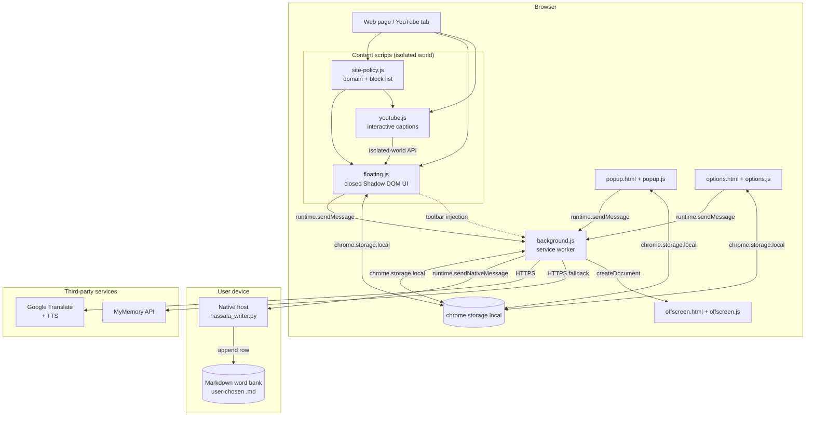
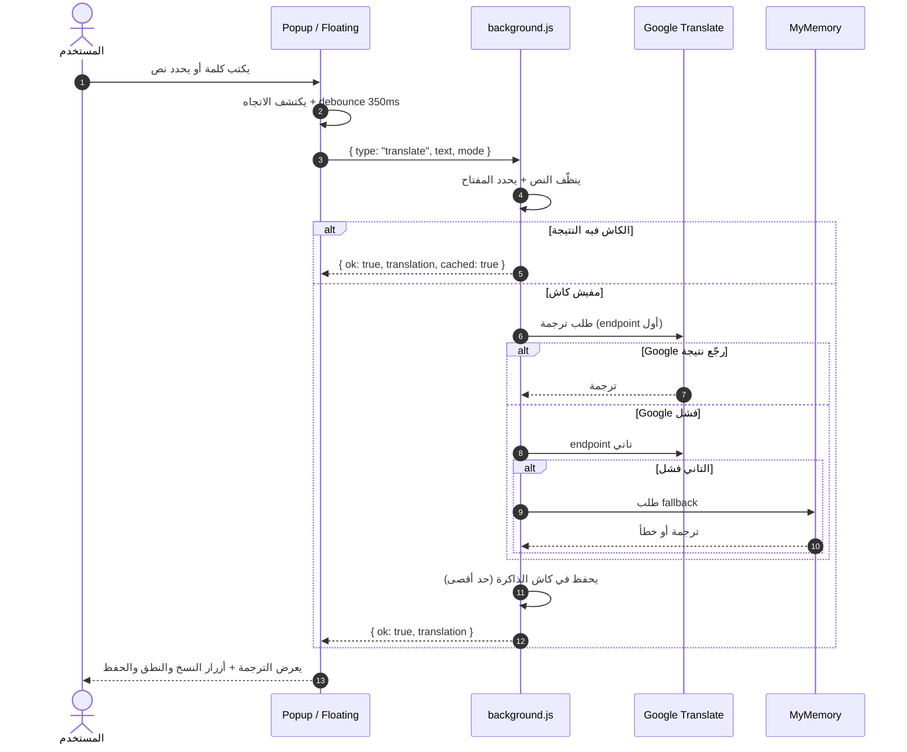
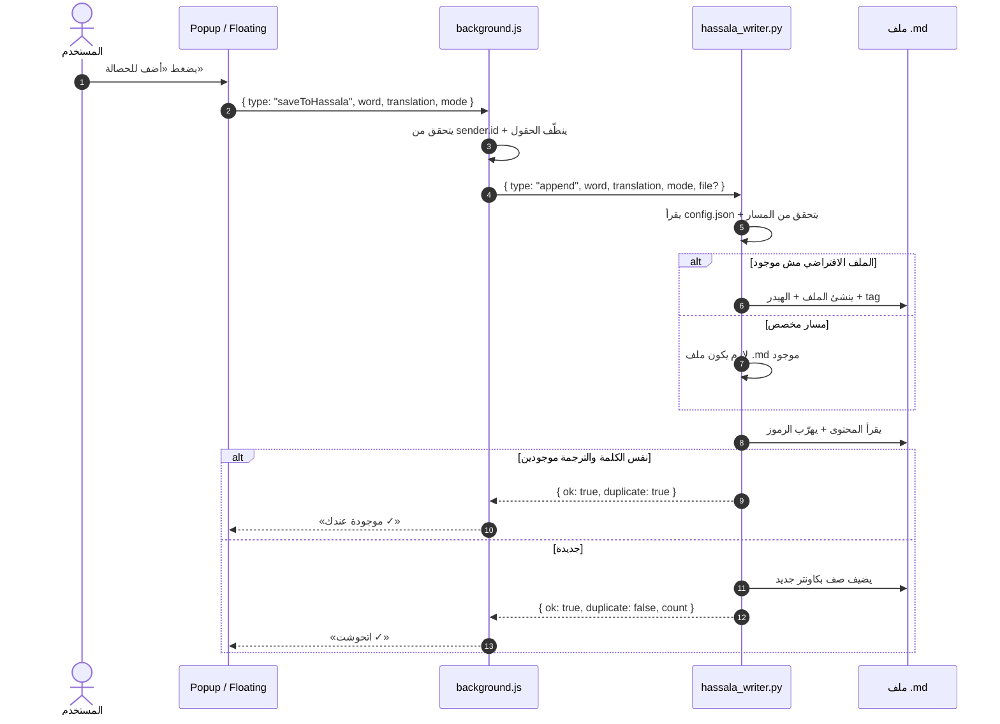
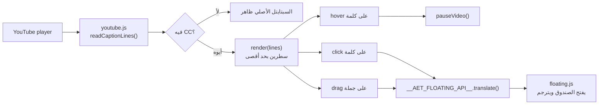

# معمارية حصالة

**آخر تحديث:** 3 نوفمبر 2026

الملف ده بيشرح إزاي حصالة متقسّمة من جوه: مين بيكلم مين، الرسائل بتمر إزاي،
وفين البيانات بتتخزن. الكود نفسه مش مربوط بأي framework، وكل ملف ليه مسؤولية
واحدة واضحة.

---

## 1) نظرة سريعة

حصالة إضافة Manifest V3 من غير build step. كل حاجة جوه الحزمة، ومفيش سيرفر
خاص بالمشروع.

**قواعد الاتجاه:**

- الصفحة ما بتكلمش الـ service worker مباشرة من كود الصفحة؛ الـ content script
  هو اللي بيكلم، والـ extension APIs مش متاحة لـ JavaScript الصفحة.
- الـ background هو الوسيط الوحيد للترجمة والحفظ والنطق.
- الـ native host ما بيكلمش أي حاجة غير الإضافة، وما بيعملش أي اتصال شبكي.

---

## 2) المكوّنات ومسؤولياتها

| المكوّن | الملف | المسؤولية |
| --- | --- | --- |
| Service worker | `src/background.js` | الترجمة، fallback، كاش، النطق، الحفظ، التحقق من المرسل، رسائل التبويب |
| الصندوق العائم | `src/content/floating.js` | واجهة الترجمة، تحديد النص، الزرار العائم، مسار الحفظ، Shadow DOM مغلق |
| سياسة المواقع | `src/content/site-policy.js` | تطبيع الدومينات، قراءة قائمة التعطيل، أحداث `storage` |
| يوتيوب | `src/content/youtube.js` | قراءة السبتايتل، عرض سطرين، الوقوف عند المرور، الترجمة عند الضغط |
| البوب | `src/popup/` | ترجمة سريعة، حفظ، فتح الملف، سجل آخر ٨ كلمات، إظهار/إخفاء الزرار العائم |
| الإعدادات | `src/options/` | مسار ملف الحصالة، متصفح الملفات، المواقع المتعطلة، الحالة |
| النطق | `src/offscreen/` | تشغيل الصوت خارج الصفحة |
| Native host | `native/hassala_writer.py` | كتابة صفوف Markdown، منع التكرار، فحص المسارات، فتح الملف |
| السكربتات | `scripts/` | فحص المشروع، بناء ZIP، توليد الأيقونات |
| الاختبارات | `tests/` | اختبار Native Host من غير أي اعتماد خارجي |

---

## 3) تدفق الترجمة

**ملاحظات:**

- الكاش في ذاكرة الـ service worker بس، وبيتمسح لما المتصفح يقفل أو الـ worker
  يتوقف. مفيش كاش دائم للنص.
- مفيش مفتاح API، ومفيش حساب. الخدمات العامة هي المصدر.
- لو كل الخدمات فشلت، الـ background بيرجّع `{ ok: false, code: 'failed' }`
  والواجهة بتعرض رسالة مفهومة.

---

## 4) تدفق الحفظ

**الضمانات:**

- الكتابة في ملف `.md` واحد بس.
- المسار المخصص لازم يكون موجود؛ الملف الافتراضي فقط هو اللي بيتعمل تلقائيًا.
- التكرار بيتم منعه بالزوج (كلمة + ترجمة) في الاتجاهين.
- الرموز `&`, `<`, `>`, `|`, `\` بتتهرّب قبل الكتابة.

---

## 5) تدفق يوتيوب

- `youtube.js` و`floating.js` في نفس الـ isolated world، فالاتصال بينهم عن
  طريق كائن `globalThis.__AET_FLOATING_API__` مش DOM event.
- ده بيمنع أي سكربت في الصفحة إنه يطلق حدث ترجمة مزيف.
- السبتايتل الأصلي بيتخفي بـ CSS، ويرجع تاني لو مفيش CC أو الموقع متعطل.

---

## 6) التخزين

| المفتاح | المكان | المحتوى | ملاحظات |
| --- | --- | --- | --- |
| `hassalaFile` | `chrome.storage.local` | مسار ملف الحصالة الكامل | المفتاح الرسمي |
| `obsidianFile` | `chrome.storage.local` | مسار من نسخة قديمة | بيتقرأ مرة واحدة، بيتنقل لـ `hassalaFile`، وبعدها بيتمسح |
| `fabHidden` | `chrome.storage.local` | هل الزرار العائم مخفي | |
| `fabPos` | `chrome.storage.local` | مكان الزرار العائم | |
| `panelPos` | `chrome.storage.local` | مكان الصندوق | |
| `panelPinned` | `chrome.storage.local` | هل الصندوق مثبّت | |
| `blockedSites` | `chrome.storage.local` | قائمة المواقع المتعطلة | |
| `history` | `chrome.storage.local` | آخر ٨ كلمات | |
| `mode` | `chrome.storage.local` | اتجاه الترجمة المفضل | |

كاش الترجمة وكاش الصوت **مش** في التخزين الدائم؛ هما `Map` جوه الـ service
worker.

---

## 7) بروتوكول الـ Native Host

الرسائل بتتبعت بـ `chrome.runtime.sendNativeMessage` بصيغة JSON، وكل رسالة
ليها `type`:

| النوع | المدخلات | المخرجات |
| --- | --- | --- |
| `info` | — | اسم الـ host، النسخة، المسار الافتراضي، حالة الملف |
| `checkFile` | `file` | `ok`, `create`, `filePath`, أو `error` |
| `append` | `word`, `translation`, `mode`, `file?` | `ok`, `duplicate`, `count`, `filePath` |
| `openFile` | `file?` | `ok` أو `error` |
| `browse` | `root`, `files`, `showHidden` | قائمة ملفات/مجلدات |

**أخطاء معروفة:** `invalid_file`, `file_missing`, `write_failed`,
`vault_missing`, `config_error`, `timeout`.

**حدود:**

- أقصى حجم رسالة 1MB.
- أقصى طول حقل 200 حرف.
- أقصى طول مسار 4096 حرف.
- الـ host بيقرأ `config.json` جنبه، وبيتحقق من `realpath` قبل أي كتابة.

---

## 8) قرارات تصميمية

### ليه Shadow DOM مغلق؟

عشان الصفحة ما تقرأش النص المترجم أو عناصر الإدخال. الـ host element نفسه
ظاهر (عشان يتموضع)، لكن المحتوى جواه مش متاح لـ `page.shadowRoot`.

### ليه الـ background هو الوسيط الوحيد؟

- بيقلل عدد الأماكن اللي بتتعامل مع الشبكة.
- بيسمح بالتحقق من `sender.id` في مكان واحد.
- بيخلي النطق والحفظ والترجمة كلهم تحت نفس سياسة الأخطاء.

### ليه Native Host مش ملف مباشر؟

المتصفح ما بيسمحش لـ extension يكتب في أي مكان على القرص. الـ host عملية
محلية منفصلة، بتتقفل على Extension ID، وبتشتغل بصلاحيات المستخدم.

### ليه مفيش build step؟

- المشروع صغير ومقروء.
- أي حد يقدر يفتح `src/` ويفهمه.
- مفيش supply chain من مكتبات خارجية.
- الـ ZIP هو نفسه الملفات المصدرية.

### ليه الخط مضمّن؟

**Baloo Bhaijaan 2** بيضمن شكل موحّد للعربي والإنجليزي على كل الأجهزة، من غير
طلب شبكة إضافي. الترخيص SIL OFL موجود في `src/fonts/OFL.txt`.

---

## 9) حدود معروفة

- الترجمة بتعتمد على خدمات عامة، وممكن تفشل أو تتغير من غير إشعار.
- الـ Native Host لازم يتثبت يدويًا، ولازم يتعاد تسجيله لو الـ Extension ID
  اتغيّر.
- صفحات `chrome://` وصفحات المتجر الداخلية مش بيشتغل عليها content script.
- الملفات الكبيرة جدًا في `browse` ممكن تكون بطيئة؛ الـ host بيرجّع قائمة
  محدودة.
- مفيش مزامنة بين الأجهزة؛ كل جهاز ليه ملفه وإعداداته.

التفاصيل الأمنية في [SECURITY.md](SECURITY.md)، وسياسة الخصوصية في
[PRIVACY.md](PRIVACY.md).
