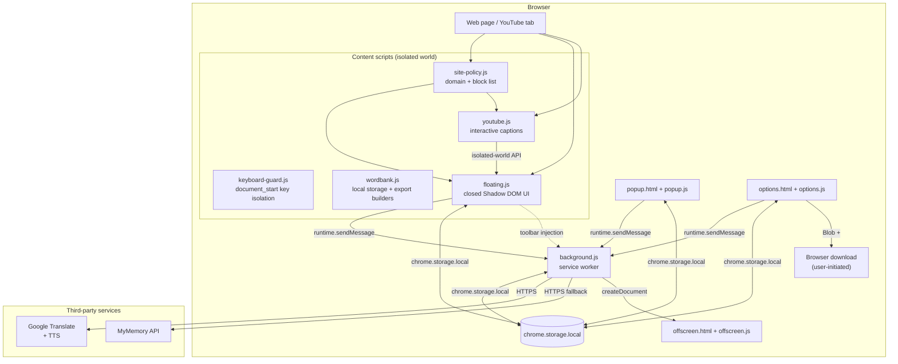
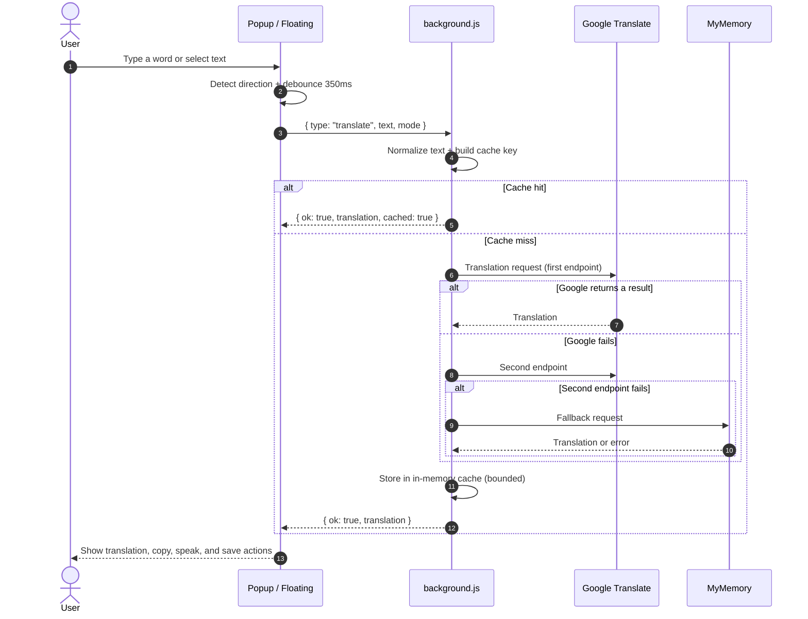
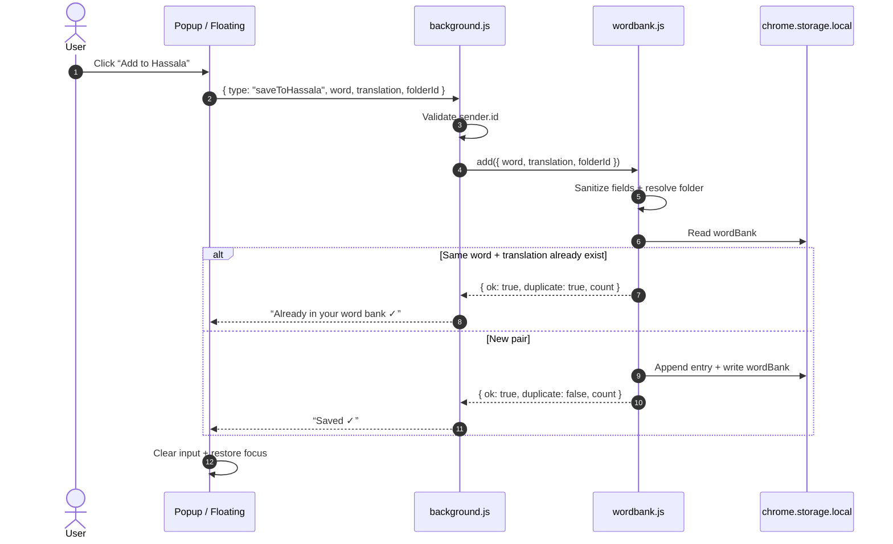
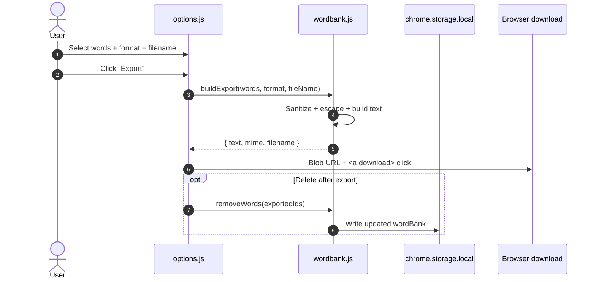
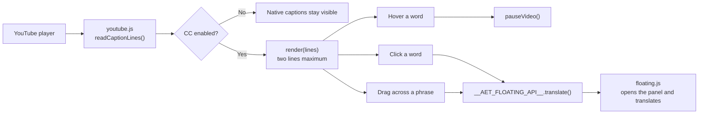

# Hassala Architecture

**Last updated:** November 4, 2026

This document explains how Hassala is structured internally: who talks to whom,
how messages flow, and where data is stored. The code is not tied to any
framework, and each file has one clear responsibility.

---

## 1. Overview

Hassala is a Manifest V3 extension with no build step. Everything is bundled
with the extension, and the project has no backend server. Saved words live in
`chrome.storage.local`; exports are normal browser downloads triggered by the
user.



**Direction rules:**

- Page JavaScript never talks to the service worker directly. The content script
  makes the call, and extension APIs are not available to page JavaScript.
- The background worker is the only bridge for translation, saving, and
  pronunciation.
- The word bank module (`src/wordbank.js`) is shared by the background worker,
  the popup, the options page, and the floating panel. It is the only code that
  reads or writes the word bank storage keys.
- Export is built in memory by `src/wordbank.js` and downloaded by the options
  page only after an explicit click. No native host or filesystem access is
  involved.

---

## 2. Components and responsibilities

| Component | File | Responsibility |
| --- | --- | --- |
| Service worker | `src/background.js` | Translation, fallback, cache, pronunciation, saving, sender validation, tab messaging |
| Word bank | `src/wordbank.js` | Local storage schema, folders, dedupe, sanitization, export builders, filename cleanup |
| Floating panel | `src/content/floating.js` | Translation UI, selection handling, floating button, folder selector, closed Shadow DOM |
| Keyboard guard | `src/content/keyboard-guard.js` | Loaded at `document_start`; keeps page shortcuts from seeing keys typed in the panel |
| Site policy | `src/content/site-policy.js` | Domain normalization, blocked-site list, `storage` events |
| YouTube | `src/content/youtube.js` | Caption reading, two-line rendering, hover pause, click-to-translate |
| Popup | `src/popup/` | Quick translation, save, folder selection, word count, last 8 words, show/hide floating button |
| Options | `src/options/` | Word bank management, folders, search, export, blocked sites, settings |
| Pronunciation | `src/offscreen/` | Audio playback outside the page |
| Scripts | `scripts/` | Project checks, ZIP packaging, icon generation |

**Keyboard isolation:**

- The floating panel lives inside a **closed shadow root**, so the page sees
  events outside it as coming from `#aet-floating-root`, not from a `textarea`.
  YouTube and other sites treat that as “not typing” and fire their shortcuts
  (Space for video, arrows for seeking).
- `keyboard-guard.js` loads at `document_start`, before page scripts, and
  registers a listener in the capture phase on `window`.
- While focus is inside the panel, the guard stops `keydown`, `keypress`, and
  `keyup` from propagating to the page, and forwards `keydown` to `floating.js`
  for `Enter` and `Escape`.
- The guard does **not** call `preventDefault` for normal keys, so the browser
  keeps natural behavior: typing spaces, caret movement, Shift selection,
  word navigation, and IME composition. This is what keeps Arabic input
  correct.

---

## 3. Translation flow



**Notes:**

- The cache lives only in service-worker memory and is cleared when the browser
  closes or the worker stops. There is no persistent text cache.
- There is no API key and no account. Public services are the source.
- If every service fails, the background returns
  `{ ok: false, code: 'failed' }`, and the UI shows a clear message.

---

## 4. Saving flow



**Guarantees:**

- Nothing is written to the user's filesystem.
- Duplicates are prevented by the word + translation pair in both directions.
- If saving fails, the input keeps its text. If the user starts typing a new
  word before the request finishes, Hassala does not erase the new text.
- Fields are sanitized, control/bidi characters are removed, and lengths are
  bounded.
- Read-modify-write operations are serialized through a promise queue so two
  quick saves cannot overwrite each other.

---

## 5. Folders and export flow



**Storage model:**

```text
wordBank       -> [{ id, word, translation, folderId }]
wordFolders    -> [{ id, name }]
activeFolderId -> id of the folder new words are saved into
```

- The default folder is `{ id: 'general', name: 'General' }` and is protected.
- Deleting another folder moves its words to the default folder.
- `MAX_WORDS = 10000`, `MAX_FOLDERS = 200`, `MAX_FIELD = 200`, and
  `MAX_FOLDER_NAME = 60`.
- Export formats are Markdown, plain text, CSV (UTF-8 BOM + formula guard), and
  JSON.
- Filenames are sanitized in `src/wordbank.js` and always receive the correct
  extension.

---

## 6. YouTube flow



- `youtube.js` and `floating.js` run in the same isolated world, so they talk
  through the `globalThis.__AET_FLOATING_API__` object instead of a DOM event.
- This prevents any page script from firing a fake translation event.
- Native captions are hidden with CSS and return when CC is off or the site is
  blocked.

---

## 7. Storage

| Key | Location | Content | Notes |
| --- | --- | --- | --- |
| `wordBank` | `chrome.storage.local` | Saved word entries | Shared schema in `src/wordbank.js` |
| `wordFolders` | `chrome.storage.local` | Folder list | Includes the protected `general` folder |
| `activeFolderId` | `chrome.storage.local` | Target folder for new words | Falls back to `general` |
| `fabHidden` | `chrome.storage.local` | Whether the floating button is hidden | |
| `fabPos` | `chrome.storage.local` | Floating button position | |
| `panelPos` | `chrome.storage.local` | Panel position | |
| `panelPinned` | `chrome.storage.local` | Whether the panel is pinned | |
| `blockedSites` | `chrome.storage.local` | Blocked sites list | |
| `history` | `chrome.storage.local` | Last 8 words | |
| `mode` | `chrome.storage.local` | Preferred translation direction | |

Translation and audio caches are **not** in persistent storage; they are `Map`
objects inside the service worker. There is no `hassalaFile` key anymore; files
are never written automatically.

---

## 8. Export formats

| Format | MIME type | Notes |
| --- | --- | --- |
| `markdown` | `text/markdown;charset=utf-8` | Two-column table: word and translation; cells escaped |
| `text` | `text/plain;charset=utf-8` | One `word — translation` pair per line |
| `csv` | `text/csv;charset=utf-8` | UTF-8 BOM; header `Word,Translation`; formula guard |
| `json` | `application/json;charset=utf-8` | Array of `{ word, translation }` objects |

The options page calls `buildExport`, creates a `Blob`, creates an object URL,
clicks a temporary `<a download>`, and revokes the URL. This requires no
`downloads` permission.

---

## 9. Design decisions

### Why a closed Shadow DOM?

So the page cannot read translated text or input elements. The host element
remains visible for positioning, but its content is not available through
`page.shadowRoot`.

### Why is the background the only bridge?

- It reduces the number of places that touch the network.
- It validates `sender.id` in one place.
- It puts pronunciation, saving, and translation under the same error policy.

### Why keep words in extension storage instead of a file?

Chrome extensions cannot write to arbitrary paths without a native host, and a
native host adds install friction and a filesystem trust boundary. Keeping words
in `chrome.storage.local` is simpler, safer, and works immediately after
installation. The user still gets a real file whenever they want one through
the explicit export flow.

### Why share `wordbank.js` with content scripts?

The popup and floating panel need to read folders, save words, and listen for
storage changes. Loading the same module in each context keeps the schema and
sanitization rules in one place. The module has no network or DOM dependencies.

### Why no build step?

- The project is small and readable.
- Anyone can open `src/` and understand it.
- There is no third-party supply chain.
- The ZIP contains the same source files.

### Why bundle the font?

**Baloo Bhaijaan 2** gives Arabic and English a consistent look on every device
without an extra network request. The SIL OFL license is in
`src/fonts/OFL.txt`.

---

## 10. Known limitations

- Translation depends on public services and may fail or change without notice.
- `chrome://` pages and internal store pages do not allow content scripts.
- There is no cross-device sync; each browser profile has its own local word
  bank. Export a JSON backup if you want to move it.
- `chrome.storage.local` has a quota. Hassala caps the bank at 10,000 words and
  reports `storage_full` if the browser quota is reached first.
- Export is a browser download; the extension cannot choose the download folder
  for you.

For security details, see [SECURITY.md](SECURITY.md). For the privacy policy,
see [PRIVACY.md](PRIVACY.md).
