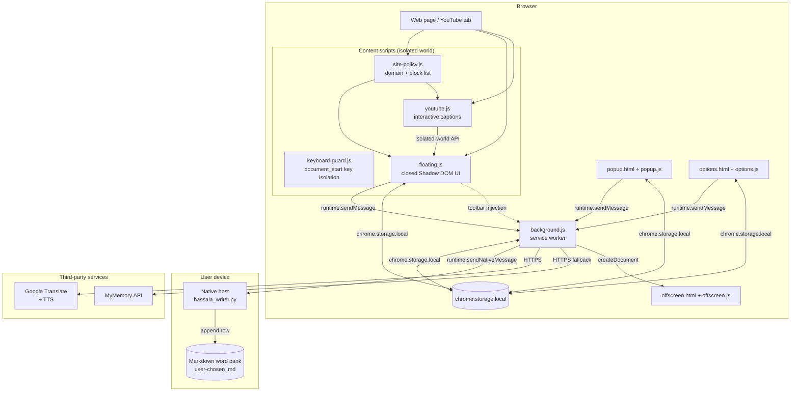
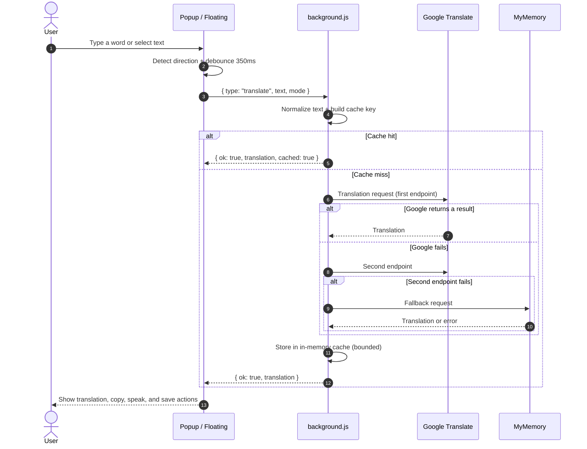
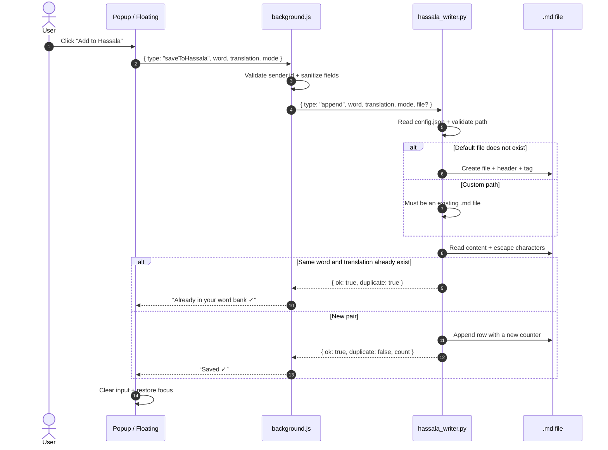
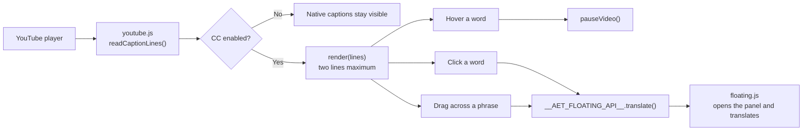

# Hassala Architecture

**Last updated:** November 3, 2026

This document explains how Hassala is structured internally: who talks to whom,
how messages flow, and where data is stored. The code is not tied to any
framework, and each file has one clear responsibility.

---

## 1. Overview

Hassala is a Manifest V3 extension with no build step. Everything is bundled
with the extension, and the project has no backend server.

**Direction rules:**

- Page JavaScript never talks to the service worker directly. The content script
  makes the call, and extension APIs are not available to page JavaScript.
- The background worker is the only bridge for translation, saving, and
  pronunciation.
- The native host talks only to the extension and makes no network connections.

---

## 2. Components and responsibilities

| Component | File | Responsibility |
| --- | --- | --- |
| Service worker | `src/background.js` | Translation, fallback, cache, pronunciation, saving, sender validation, tab messaging |
| Floating panel | `src/content/floating.js` | Translation UI, selection handling, floating button, save path, closed Shadow DOM |
| Keyboard guard | `src/content/keyboard-guard.js` | Loaded at `document_start`; keeps page shortcuts from seeing keys typed in the panel |
| Site policy | `src/content/site-policy.js` | Domain normalization, blocked-site list, `storage` events |
| YouTube | `src/content/youtube.js` | Caption reading, two-line rendering, hover pause, click-to-translate |
| Popup | `src/popup/` | Quick translation, save, open file, last 8 words, show/hide floating button |
| Options | `src/options/` | Word bank path, file browser, blocked sites, status |
| Pronunciation | `src/offscreen/` | Audio playback outside the page |
| Native host | `native/hassala_writer.py` | Append Markdown rows, dedupe, path validation, open file |
| Scripts | `scripts/` | Project checks, ZIP packaging, icon generation |
| Tests | `tests/` | Native host tests with no external dependencies |

**Keyboard isolation:**

- The floating panel lives inside a **closed shadow root**, so the page sees
  events outside it as coming from `#aet-floating-root`, not from a `textarea`.
  YouTube and other sites treat that as “not typing” and fire their shortcuts
  (Space for video, arrows for seeking).
- `keyboard-guard.js` loads at `document_start`, before page scripts, and
  registers a listener in the capture phase on `window`.
- While focus is inside the panel, the guard stops `keydown`, `keypress`, and
  `keyup` from propagating to the page, and forwards `keydown` to `floating.js`
  for `Enter`, `Escape`, and the save-path dialog.
- The guard does **not** call `preventDefault` for normal keys, so the browser
  keeps natural behavior: typing spaces, caret movement, Shift selection,
  word navigation, and IME composition. This is what keeps Arabic input
  correct.

---

## 3. Translation flow

**Notes:**

- The cache lives only in service-worker memory and is cleared when the browser
  closes or the worker stops. There is no persistent text cache.
- There is no API key and no account. Public services are the source.
- If every service fails, the background returns
  `{ ok: false, code: 'failed' }`, and the UI shows a clear message.

---

## 4. Saving flow

**Guarantees:**

- Writes go to exactly one `.md` file.
- A custom path must already exist; only the default file may be created
  automatically.
- Duplicates are prevented by the word + translation pair in both directions.
- If saving fails, the input keeps its text. If the user starts typing a new
  word before the request finishes, Hassala does not erase the new text.
- `&`, `<`, `>`, `|`, and `\` are escaped before writing.

---

## 5. YouTube flow

- `youtube.js` and `floating.js` run in the same isolated world, so they talk
  through the `globalThis.__AET_FLOATING_API__` object instead of a DOM event.
- This prevents any page script from firing a fake translation event.
- Native captions are hidden with CSS and return when CC is off or the site is
  blocked.

---

## 6. Storage

| Key | Location | Content | Notes |
| --- | --- | --- | --- |
| `hassalaFile` | `chrome.storage.local` | Full word bank file path | Current key |
| `obsidianFile` | `chrome.storage.local` | Path from an older version | Read once, migrated to `hassalaFile`, then removed |
| `fabHidden` | `chrome.storage.local` | Whether the floating button is hidden | |
| `fabPos` | `chrome.storage.local` | Floating button position | |
| `panelPos` | `chrome.storage.local` | Panel position | |
| `panelPinned` | `chrome.storage.local` | Whether the panel is pinned | |
| `blockedSites` | `chrome.storage.local` | Blocked sites list | |
| `history` | `chrome.storage.local` | Last 8 words | |
| `mode` | `chrome.storage.local` | Preferred translation direction | |

Translation and audio caches are **not** in persistent storage; they are `Map`
objects inside the service worker.

---

## 7. Native host protocol

Messages are sent with `chrome.runtime.sendNativeMessage` as JSON, and every
message has a `type`:

| Type | Input | Output |
| --- | --- | --- |
| `info` | — | Host name, version, default path, file status |
| `checkFile` | `file` | `ok`, `create`, `filePath`, or `error` |
| `append` | `word`, `translation`, `mode`, `file?` | `ok`, `duplicate`, `count`, `filePath` |
| `openFile` | `file?` | `ok` or `error` |
| `browse` | `root`, `files`, `showHidden` | File/folder list |

**Known errors:** `invalid_file`, `file_missing`, `write_failed`,
`vault_missing`, `config_error`, `timeout`.

**Limits:**

- Maximum message size: 1 MB.
- Maximum field length: 200 characters.
- Maximum path length: 4096 characters.
- The host reads `config.json` next to it and resolves `realpath` before any
  write.

---

## 8. Design decisions

### Why a closed Shadow DOM?

So the page cannot read translated text or input elements. The host element
remains visible for positioning, but its content is not available through
`page.shadowRoot`.

### Why is the background the only bridge?

- It reduces the number of places that touch the network.
- It validates `sender.id` in one place.
- It puts pronunciation, saving, and translation under the same error policy.

### Why a native host instead of writing directly?

Browsers do not allow extensions to write anywhere on disk. The host is a
separate local process, restricted to the extension ID, running with the user's
permissions.

### Why no build step?

- The project is small and readable.
- Anyone can open `src/` and understand it.
- There is no third-party supply chain.
- The ZIP contains the same source files.

### Why bundle the font?

**Baloo Bhaijaan 2** gives Arabic and English a consistent look on every device
without an extra network request. The SIL OFL license is in
`src/fonts/OFL.txt`.

---

## 9. Known limitations

- Translation depends on public services and may fail or change without notice.
- The native host must be installed manually and re-registered if the extension
  ID changes.
- `chrome://` pages and internal store pages do not allow content scripts.
- Very large folders in `browse` may be slow; the host returns a bounded list.
- There is no cross-device sync; each device has its own file and settings.

For security details, see [SECURITY.md](SECURITY.md). For the privacy policy,
see [PRIVACY.md](PRIVACY.md).
